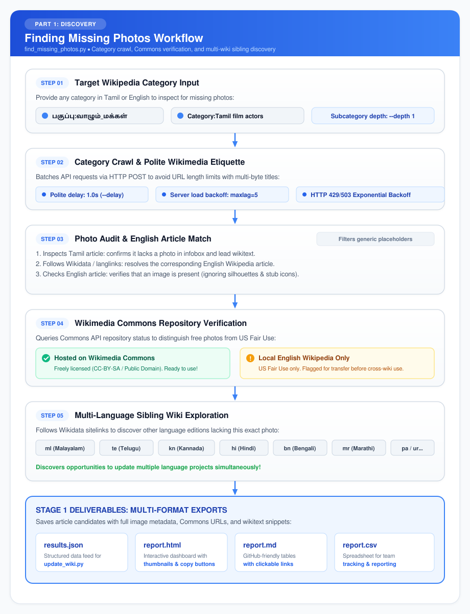
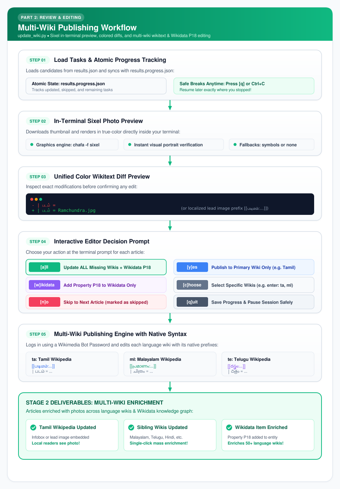
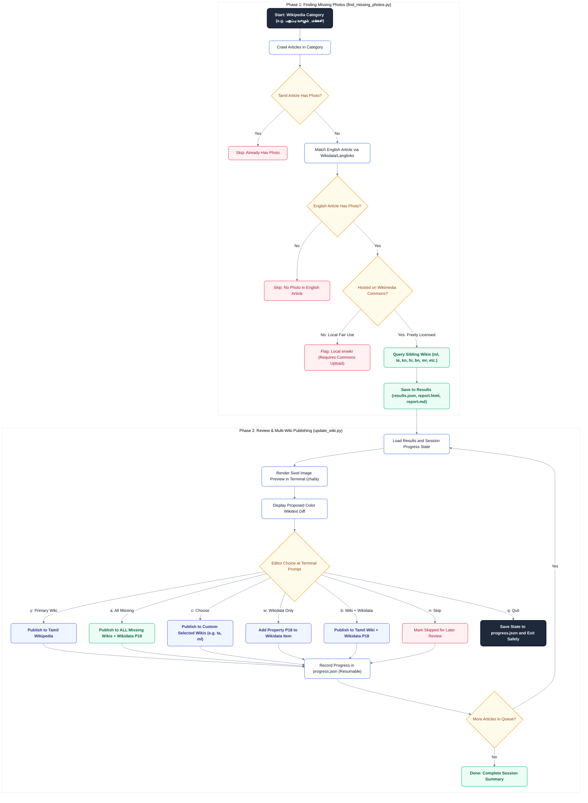

# WikiPhotoFinder

**An All-in-One Wikimedia Photo Discovery, In-Terminal Preview, and Cross-Language Updating Toolkit.**

---

## 📖 Introduction: What is WikiPhotoFinder?

Across Wikimedia projects, there is a massive multimedia knowledge gap: **thousands of biographical and topical articles on language Wikipedias (Tamil, Malayalam, Telugu, Kannada, Hindi, Bengali, Marathi, etc.) lack photographs**, even though high-quality images already exist on English Wikipedia and Wikimedia Commons. Furthermore, many Wikidata entities lack the central Property **`P18` (image)** claim that automatically populates infoboxes across 50+ language editions.

**WikiPhotoFinder** is a comprehensive, production-grade Python toolchain created for Wikimedia contributors, bot operators, and language communities. It bridges this gap with an end-to-end workflow:

1. 🔍 **Automated Missing Photo Discovery:** Crawls any category on Tamil or English Wikipedia (with recursive subcategory support), compares image metadata across language editions, and identifies articles where the English Wikipedia article has a photo but other language editions do not.
2. 🌐 **Cross-Wiki Multi-Language Exploration:** Queries Wikidata to discover all sister language editions linked to each article (`ta`, `ml`, `te`, `kn`, `hi`, `bn`, `mr`, `pa`, `ur`, etc.) and determines which of them also lack photos.
3. 📁 **Commons vs. Fair Use Verification:** Automatically checks Wikimedia Commons API to confirm if an image is freely hosted on Commons (ready for immediate cross-wiki use) or restricted to local English Wikipedia Fair Use.
4. 🖼️ **In-Terminal Sixel Photo Previews:** Uses `chafa` to render real full-color image thumbnails directly inside your terminal before you confirm any edits.
5. 💾 **Resumable Batch Review Workflow:** Automatically tracks progress in `<file>.progress.json`, allowing contributors to safely pause anytime (`q` or `Ctrl+C`) and resume later without repeating work.
6. ✏️ **Intelligent Multi-Wiki Publishing:** Automatically logs in via Wikimedia Bot Passwords and intelligently inserts images into local wikitext—either by populating empty infobox parameters (`| படம் =`, `| చిత్రం =`, `| चित्र =`, `| image =`) or prepending localized lead image tags (`[[படிமம்:...]]`, `[[പ്രമാണം:...]]`, `[[దస్త్రం:...]]`, `[[चित्र:...]]`).
7. 🌟 **Wikidata Property P18 Integration:** With one keystroke, adds Property `P18` directly to the central Wikidata entity, enriching Wikidata-driven infoboxes across 50+ languages simultaneously.
8. 🛡️ **Strict Wikimedia Etiquette:** Fully compliant with Wikimedia Bot Policies, featuring default 1.0s polite delays (`--delay`), `maxlag=5` server load monitoring, HTTP 429/503 exponential backoff, HTTP POST batching (eliminating HTTP 414 URI errors), and transparent User-Agent headers.
9. 📊 **Multi-Format Export:** Generates interactive self-contained HTML dashboards (with search and 1-click wikitext copy), Markdown tables, CSV spreadsheets, and JSON files.

---

## ✨ Core Features at a Glance

| Feature | Description |
|---|---|
| **Dual Category Crawler** | Scans categories from Tamil Wikipedia (`பகுப்பு:...`) or English Wikipedia (`Category:...`). |
| **Subcategory Traversal** | Configurable depth (`--depth 0`, `--depth 1`, `--depth 2`) to scan full category trees. |
| **Multi-Language Discovery** | Finds missing photos across Indic and global language editions (`ml`, `te`, `kn`, `hi`, `bn`, `mr`, etc.). |
| **Multi-Wiki Mass Publishing** | Update Tamil + sibling language wikis in a single click (`[a]ll` or `--update-linked-wikis`). |
| **Wikidata P18 Claim Editor** | Directly adds `P18` image claims to Wikidata items via `wbcreateclaim`. |
| **Sixel Terminal Graphics** | High-fidelity terminal image preview via `chafa -f sixel`. |
| **Resumable Review State** | Atomic `<file>.progress.json` state manager for reviewing large sets with breaks anytime. |
| **Smart Infobox Formatting** | Fills empty infobox parameters or adds parameters cleanly without corrupting templates. |
| **Interactive HTML Reports** | Generates standalone HTML dashboards with image thumbnails and instant copy buttons. |
| **Bot Policy & Server Protection** | Built-in rate limiting (`--delay`), `maxlag=5` load backoff, and retry handling. |

---

## 🗺️ How It Works: Visual Flowcharts for New Wiki Users

The toolchain is organized into two intuitive phases, each with its own visual guide:

---

### 1. 🔍 Finding Missing Photos (`find_missing_photos.py`)

This phase crawls a Wikipedia category, checks for missing photos, verifies Commons licensing, and discovers linked sibling language wikis:

<p align="center">
  <a href="docs/find_photos_flow.png"></a>
</p>

---

### 2. ✏️ Reviewing & Multi-Wiki Publishing (`update_wiki.py`)

This phase provides in-terminal Sixel photo verification, color diff review, and 1-click publishing to Tamil Wikipedia, sibling language wikis, and Wikidata Property P18:

<p align="center">
  <a href="docs/update_wiki_flow.png"></a>
</p>

---

### 📊 Complete Interactive Mermaid Chart

<details>
<summary><b>Click to expand full interactive Mermaid flowchart</b></summary>


</details>

### 🔰 Step-by-Step Explanation for Beginners

1. **Category Crawling:**
   * Wikipedia organizes related articles into categories (e.g., `பகுப்பு:இந்திய எழுத்தாளர்கள்` for Indian writers).
   * The tool queries the MediaWiki API to list all articles in the specified category (and optionally subcategories).

2. **Language Matching & Commons Verification:**
   * For every Tamil article that lacks an image, the tool checks its English counterpart.
   * If the English article has a photo, the tool inspects where that image is hosted:
     * **Wikimedia Commons (Shared):** Free license (CC-BY-SA, Public Domain). Ready to use immediately across all Wikimedia projects!
     * **Local English Wikipedia (Fair Use):** Restricted under US Fair Use. Cannot be directly linked in other wikis until a free version is uploaded to Commons.

3. **Multi-Language Exploration:**
   * Using Wikidata's knowledge graph, the tool discovers if the same person/topic has articles in Malayalam (`ml`), Telugu (`te`), Kannada (`kn`), Hindi (`hi`), Bengali (`bn`), Marathi (`mr`), Punjabi (`pa`), Urdu (`ur`), etc.
   * It checks each language edition to see if it also lacks the photo.

4. **Visual Review & Publishing:**
   * The terminal displays the actual photo using **Sixel graphics** (via `chafa`) alongside a colored wikitext diff.
   * You choose whether to update just the Tamil article (`y`), **all missing language editions at once (`a`)**, add the photo to **Wikidata Property P18 (`w`)**, or skip (`n`).
   * **Take breaks anytime:** Pressing `q` or `Ctrl+C` saves your exact place in `<filename>.progress.json`. When you resume, it skips all previously completed articles!

---

## 🚀 Quick Start

### 1. Installation

Ensure Python 3.9+ and `chafa` (for terminal image previews) are installed:

```bash
# On Debian / Ubuntu:
sudo apt install chafa

# Install Python requirements
pip install -r requirements.txt
```

### 2. Basic Search (`find_missing_photos.py`)

Run the scanner on any Tamil or English category:

```bash
# Scan a Tamil Wikipedia category
python3 find_missing_photos.py "பகுப்பு:தமிழ்த் திரைப்பட நடிகர்கள்"

# Scan an English category and output to JSON
python3 find_missing_photos.py "Category:Tamil film editors" --wiki en -o results.json

# Scan with subcategories and batch limit
python3 find_missing_photos.py -c "பகுப்பு:வாழும்_மக்கள்" --depth 1 --limit 100 -o results.json
```

Terminal Output:
```text
   Tamil Wikipedia Articles Missing Photos (Category: பகுப்பு:தமிழ்த் திரைப்பட நடிகர்கள்)   
╭────┬───────────────┬──────────────┬───────────────────────────┬───────────┬──────────────╮
│  # │ Tamil Article │ English      │ Photo (English/Commons)   │ Commons?  │ Wikitext to  │
├────┼───────────────┼──────────────┼───────────────────────────┼───────────┼──────────────┤
│  1 │ கார்த்திக்     │ Karthik      │ Navarasa nayagan...       │    Yes    │ [[படிமம்:... │
│  2 │ பிரசன்னா      │ Prasanna     │ Actor Prasanna...         │    Yes    │ [[படிமம்:... │
│  3 │ ராமராஜன்      │ Ramarajan    │ Ramarajan.jpg             │    Yes    │ [[படிமம்:... │
╰────┴───────────────┴──────────────┴───────────────────────────┴───────────┴──────────────╯
Scanned 35 articles in category. Found 11 articles missing photos in Tamil Wiki (7 available on Commons).
```

---

## 🌐 Cross-Wiki Multi-Language Discovery & Updating

When an article has a photo on English Wikipedia or Wikimedia Commons, that photo can benefit not only Tamil Wikipedia, but **all other language editions** of Wikipedia where the article exists!

### 1. Sibling Language Discovery (`--check-linked-wikis`)

Add `--check-linked-wikis` to inspect sibling language wikis for each candidate article:

```bash
# Check all Indian language editions (ml, te, kn, hi, bn, mr, pa, ur, etc.)
python3 find_missing_photos.py -c "பகுப்பு:இந்திய எழுத்தாளர்கள்" --check-linked-wikis --target-wikis indic -o results.json

# Check Dravidian language editions (ta, ml, te, kn)
python3 find_missing_photos.py -c "பகுப்பு:வாழும்_மக்கள்" --check-linked-wikis --target-wikis dravidian -o results.json

# Check ALL linked language editions worldwide
python3 find_missing_photos.py -c "பகுப்பு:தமிழ்நாட்டு நபர்கள்" --check-linked-wikis --target-wikis all -o results.json
```

Terminal Output with Multi-Language Status:
```text
     Tamil Wikipedia Articles Missing Photos (Category: பகுப்பு:இந்திய எழுத்தாளர்கள்)     
╭───┬──────────────────┬─────────────────┬─────────────────┬──────────┬─────────────┬────────────╮
│   │ Tamil            │ English         │ Photo           │ Commons? │ Also        │ Wikitext   │
│ # │ Article          │ Article         │ Available       │          │ Missing In  │ to Add     │
├───┼──────────────────┼─────────────────┼─────────────────┼──────────┼─────────────┼────────────┤
│ 1 │ அங்கனா பி.       │ Angana P.       │ Angana          │   Yes    │ pa, te      │ [[படிமம்:… │
│   │ சாட்டர்ஜி        │ Chatterji       │ Chatterji.jpg   │          │             │            │
│ 2 │ அர்ச்சனா (நடிகை) │ Archana         │ Archana_.jpg    │   Yes    │ bn, ml, mr, │ [[படிமம்:… │
│   │                  │ (actress)       │                 │          │ pa, ur      │            │
╰───┴──────────────────┴─────────────────┴─────────────────┴──────────┴─────────────┴────────────╯
```

Notice the **"Also Missing In"** column: it immediately highlights which sibling wikis lack photos, saving hours of manual interwiki checking!

---

### 2. Multi-Wiki Language Syntax Support

Each language Wikipedia uses native template names and image namespace prefixes. WikiPhotoFinder automatically adapts its wikitext formatting based on the target wiki:

| Language | Code | Native File Prefix | Infobox Template Pattern | Recognized Image Parameters | Standard Edit Summary |
|---|:---:|---|---|---|---|
| **Tamil** | `ta` | `[[படிமம்:...]]` | `{{...தகவல்சட்டம்...}}` | `\| படம் =`, `\| படிமம் =`, `\| image =` | `படிமம் சேர்த்தல் (via WikiPhotoFinder)` |
| **Malayalam** | `ml` | `[[പ്രമാണം:...]]` | `{{...വിവരപ്പെട്ടി...}}` | `\| ചിത്രം =`, `\| image =` | `ചിത്രം ചേർക്കൽ (via WikiPhotoFinder)` |
| **Telugu** | `te` | `[[దస్త్రం:...]]` | `{{...సమాచారపెట్టె...}}` | `\| చిత్రం =`, `\| image =` | `చిత్రం చేర్చడం (via WikiPhotoFinder)` |
| **Kannada** | `kn` | `[[ಚಿತ್ರ:...]]` | `{{...ಮಾಹಿತಿ ಚೌಕಟ್ಟು...}}` | `\| ಚಿತ್ರ =`, `\| image =` | `ಚಿತ್ರ ಸೇರಿಸಲಾಗಿದೆ (via WikiPhotoFinder)` |
| **Hindi** | `hi` | `[[चित्र:...]]` | `{{...ज्ञानसन्दूक...}}` | `\| चित्र =`, `\| image =` | `चित्र जोड़ा (via WikiPhotoFinder)` |
| **Bengali** | `bn` | `[[চিত্র:...]]` | `{{...তথ্যছক...}}` | `\| ছবি =`, `\| চিত্র =`, `\| image =` | `ছবি যোগ (via WikiPhotoFinder)` |
| **Marathi** | `mr` | `[[चित्र:...]]` | `{{...माहितीचौकट...}}` | `\| चित्र =`, `\| image =` | `चित्र जोडले (via WikiPhotoFinder)` |
| **Punjabi** | `pa` | `[[ਤਸਵੀਰ:...]]` | `{{Infobox...}}` | `\| image =` | `ਤਸਵੀਰ ਜੋੜੀ (via WikiPhotoFinder)` |
| **Urdu** | `ur` | `[[تصویر:...]]` | `{{خانہ معلومات...}}` | `\| تصویر =`, `\| image =` | `تصویر شامل کی گئی (via WikiPhotoFinder)` |
| **Other / Global** | any | `[[File:...]]` | `{{Infobox...}}` | `\| image =`, `\| photo =` | `Add image (via WikiPhotoFinder)` |

---

## 🔐 Publishing & Reviewing Edits (`update_wiki.py`)

### Step 1: Create a Bot Password
1. Log in to your Wikimedia account at [Special:BotPasswords](https://meta.wikimedia.org/wiki/Special:BotPasswords) (or on your home wiki, e.g. [ta.wikipedia.org/wiki/Special:BotPasswords](https://ta.wikipedia.org/wiki/Special:BotPasswords)).
2. Name your bot (e.g. `PhotoUpdater`) and grant **"High-volume editing"** and **"Edit existing pages"** (`editpage`).
3. Bot Passwords work across all Wikimedia language projects where your account exists.
4. Export credentials to your environment:
   ```bash
   export WIKI_USER="YourUser@PhotoUpdater"
   export WIKI_PASSWORD="your-32-character-bot-password"
   ```

---

### Step 2: Resumable Interactive Review & Multi-Wiki Publishing

Start an interactive review session from your results file:

```bash
python3 update_wiki.py --from-file results.json --interactive
```

#### What Happens During Review:
1. **Terminal Sixel Image Preview:** The photo is fetched and rendered in full color directly inside your terminal using `chafa`.
2. **Linked Wikis Discovery:** Real-time check of all sibling language editions and Wikidata item `P18`.
3. **Colored Wikitext Diff:** Shows unified line-by-line diffs (`+` in green, `-` in red).
4. **Multi-Wiki Interactive Prompt:**

```text
────────────────────────────────────────────────────────────
[1/20] Article: அர்ச்சனா (நடிகை) (ta.wikipedia.org)
    Photo:   Archana_.jpg (Commons: Yes)
    Page:    https://commons.wikimedia.org/wiki/File:Archana_.jpg
    Wikidata: Q3531820 (P18: Missing on Wikidata! Can be added)

    🌐 Linked Language Wikis:
       Missing photo: bn (অর্চনা (অভিনেত্রী)), ml (അർച്ചന (ചലച്ചിത്രനടി)), mr (अर्चना (अभिनेत्री)), pa (ਅਰਚਨਾ(ਅਭਿਨੇਤਰੀ)), ur (ارچنا (اداکارہ))
       Already has photo: kn (ಅರ್ಚನಾ), te (అర్చన (నటి))

--- Proposed Wikitext Diff (ta.wikipedia.org: அர்ச்சனா (நடிகை)) ---
--- a/அர்ச்சனா (நடிகை)
+++ b/அர்ச்சனா (நடிகை)
@@ -1,3 +1,5 @@
+[[படிமம்:Archana_.jpg|thumb|அர்ச்சனா (நடிகை)]]
+
 {{Infobox person
 | name               = அர்ச்சனா<br />Archana
-------------------------------------------------------

Publish edit? [y]es (ta) / [a]ll missing (ta, ml, mr, pa, ur) / [c]hoose wikis / [w]ikidata only / [b]oth (ta+wikidata) / [n]o (skip) / [p]review / [q]uit:
```

#### Interactive Prompt Actions:
* **`a` (all missing)**: **The Power Action!** Publishes to **all missing linked language wikis** (`ta`, `ml`, `mr`, `pa`, `ur`) AND adds Property `P18` to Wikidata in one unified step!
* **`y` (yes)**: Publishes only to the primary wiki (`ta` by default).
* **`c` (choose)**: Prompts you to enter a custom comma-separated list of wikis (e.g. `ta, ml`).
* **`b` (both)**: Publishes to the primary wiki AND adds Property `P18` to Wikidata.
* **`w` (wikidata only)**: Adds Property `P18` to Wikidata without modifying article wikitext.
* **`n` / `Enter`**: Skips this article and marks it as skipped in the progress state.
* **`p` (preview)**: Re-renders the Sixel photo preview in the terminal.
* **`q` (quit)**: Saves your progress state and safely exits.

---

### Step 3: Pausing and Resuming Anytime

Reviewing 400+ articles in one sitting is impossible. WikiPhotoFinder is built from the ground up to be **fully resumable**:

* Whenever you press **`q`** or **`Ctrl+C`**, your session is automatically saved to `<filename>.progress.json`.
* When you run the exact same command later:
  ```bash
  python3 update_wiki.py --from-file results.json --interactive
  ```
* It reloads your session and resumes seamlessly:
  ```text
  📊 Resumable Session: results.json
     • Primary Wiki:        ta.wikipedia.org
     • Total tasks in file: 423
     • Previously updated:  35
     • Previously skipped:  12
     • Remaining to review: 376
     • Progress file:       results.progress.json
  ```

---

## 💡 Advanced Commands & Examples

### 1. Safe Dry Run (Preview without Editing)
Inspect proposed diffs across all missing wikis without logging in or publishing:
```bash
python3 update_wiki.py --article "அர்ச்சனா (நடிகை)" --image "Archana_.jpg" --update-linked-wikis --dry-run
```

### 2. Update All Missing Wikis Automatically
Skip asking per wiki and update all missing language editions:
```bash
python3 update_wiki.py --from-file results.json --interactive --update-linked-wikis
```

### 3. Target a Specific Language Edition
Use `--wiki` to run updates directly on Malayalam (`ml`), Telugu (`te`), Kannada (`kn`), Hindi (`hi`), or any other wiki:
```bash
python3 update_wiki.py --wiki ml --article "അർച്ചന (ചലച്ചിത്രനടി)" --image "Archana_.jpg" --interactive
```

### 4. Interactive HTML Dashboard with Copy Buttons
Export search results to a self-contained web report:
```bash
python3 find_missing_photos.py "பகுப்பு:இந்திய எழுத்தாளர்கள்" -o report.html
```
Open `report.html` in your web browser to:
- View visual side-by-side thumbnails.
- Filter by Commons vs. Local English Wikipedia images.
- Use **1-click Copy** buttons for wikitext and infobox lines.

### 5. Re-Review Previously Skipped Articles
```bash
python3 update_wiki.py --from-file results.json --interactive --retry-skipped
```

---

## 🛡️ Wikimedia Server Etiquette & Anti-DOS Protection

WikiPhotoFinder is built to operate as a polite, robust citizen of the Wikimedia API ecosystem, strictly adhering to [Wikimedia User-Agent and Bot Policies](https://meta.wikimedia.org/wiki/User-Agent_policy):

### 1. Polite Request Pacing (`--delay`)
- **Default:** `1.0s` between consecutive API requests.
- Helps ensure your bot never floods Squid/Varnish caching layers or triggers automated IP throttling.
- Can be customized with `--delay 2.0` for extra-gentle background runs.

### 2. Database Replication Lag Monitoring (`--maxlag`)
- **Default:** `5` seconds.
- MediaWiki uses the `maxlag` parameter to inform clients when backend database replicas are lagging behind the primary master.
- When replication lag exceeds the threshold, Wikimedia returns an HTTP 200 response with `{"error": {"code": "maxlag"}}` and a `Retry-After` header.
- **Smart Retries:** The tool automatically pauses for the duration specified by the server (with exponential backoff) and retries up to 5 times.
- **Smart Wikidata Handling:** On Wikidata, read-only `wbgetentities` lookups read directly from the main database and object cache. However, Wikidata's separate Query Service (WDQS) frequently has baseline replication lag of 5–30 seconds. WikiPhotoFinder intelligently bypasses `maxlag` on read-only Wikidata lookups to avoid false-positive rejections, while strictly maintaining `maxlag=5` for all database-modifying edit operations (`wbcreateclaim` and `action=edit`).

### 3. HTTP 429 & 503 Exponential Backoff
- Automatically catches HTTP 429 ("Too Many Requests") and HTTP 503 ("Service Unavailable").
- Extracts the standard `Retry-After` header and backs off exponentially before retrying.

### 4. HTTP POST Batching (No HTTP 414 "URI Too Long")
- When querying batches of 50 multi-byte Unicode article titles (e.g. Tamil script), standard `GET` URLs easily exceed the 8 KB proxy URI limit.
- WikiPhotoFinder automatically executes batch queries via HTTP `POST`, completely eliminating HTTP 414 errors.

### 5. Isolated Sibling Wiki Enrichment
- When running `--check-linked-wikis`, the cross-wiki sitelink lookup is safely isolated.
- If Wikidata or an individual sister wiki experiences temporary upstream lag or network timeouts, the tool logs a warning and proceeds with your primary category findings without losing data.

### 6. Transparent User-Agent Identification (`--user-agent`)
- Automatically formats your `User-Agent` header to identify your bot account and tool:
  ```text
  WikiPhotoFinder/1.1 (https://ta.wikipedia.org/wiki/User:<username>; Multi-Wiki Photo Tool)
  ```
- Allows Wikimedia system administrators to identify and contact you if needed.

---

## 🛠️ CLI Reference

### `find_missing_photos.py`

```text
usage: find_missing_photos.py [-h] [-c CATEGORY_OPT] [-w {auto,ta,en}]
                             [-d DEPTH] [-l LIMIT] [-t DELAY]
                             [--timeout TIMEOUT] [--maxlag MAXLAG]
                             [--user-agent UA] [-o OUTPUT]
                             [-f {table,md,csv,json,html}] [--commons-only]
                             [--check-linked-wikis] [--target-wikis TARGET]
                             [--version]
                             [category]

positional arguments:
  category              Category name in Tamil or English

options:
  -h, --help            Show help message and exit
  -c, --category-name   Alternative way to provide category name
  -w, --wiki {auto,ta,en}
                        Category source wiki: 'ta', 'en', or 'auto' (default: auto)
  -d, --depth DEPTH     Subcategory recursion depth (default: 0)
  -l, --limit LIMIT     Maximum number of articles to inspect (default: 0 for unlimited)
  -t, --delay DELAY     Polite delay between API calls in seconds (default: 1.0s)
  --timeout TIMEOUT     HTTP timeout in seconds (default: 30.0s)
  --maxlag MAXLAG       Wikimedia maxlag server protection (default: 5s)
  --user-agent UA       Custom User-Agent header (defaults to your bot/account)
  -o, --output OUTPUT   File path to save results (.html, .md, .csv, .json)
  -f, --format {table,md,csv,json,html}
                        Force output format (default: deduced from output filename)
  --commons-only        Only show photos hosted on Wikimedia Commons
  --check-linked-wikis  Check other language Wikipedia editions (via Wikidata) to see which also lack photos
  --target-wikis TARGET Target languages to check: 'indic' (default), 'all', or 'ml,te,kn'
  --version             Show program's version number and exit
```

---

### `update_wiki.py`

```text
usage: update_wiki.py [-h] [--wiki WIKI] [--article ARTICLE] [--image IMAGE]
                      [--from-file FROM_FILE] [--interactive] [--dry-run]
                      [--update-linked-wikis] [--target-wikis TARGET]
                      [--summary SUMMARY] [-t DELAY] [--timeout TIMEOUT]
                      [--maxlag MAXLAG] [--state-file STATE_FILE] [--reset]
                      [--retry-skipped]
                      [--image-format {sixel,symbols,auto,none}]
                      [--image-size IMAGE_SIZE] [-w] [--wikidata-only]

options:
  -h, --help            Show help message and exit
  --wiki WIKI           Primary target wiki language code (default: 'ta')
  --article ARTICLE     Single article title to update
  --image IMAGE         Image filename to add
  --from-file FROM_FILE Path to results.json generated by find_missing_photos.py
  --interactive         Interactively review image, diff, and confirm each edit
  --update-linked-wikis Automatically prompt and update all missing linked language wikis
  --target-wikis TARGET Linked languages to check: 'indic' (default), 'all', or 'ml,te,kn'
  --dry-run             Show images and diffs without logging in or editing
  --summary SUMMARY     Edit summary (default: language-specific standard summary)
  -t, --delay DELAY     Delay between edits in seconds (default: 1.0s)
  --timeout TIMEOUT     HTTP request timeout in seconds (default: 30.0s)
  --maxlag MAXLAG       Wikimedia maxlag parameter (default: 5s)
  --state-file PATH     Custom path for progress state file (default: <file>.progress.json)
  --reset               Reset progress state and review from task #1
  --retry-skipped       Re-review articles previously skipped
  --image-format FORMAT Terminal image format: sixel, symbols, auto, none (default: sixel)
  --image-size GEOM     Terminal preview image geometry (default: 45x25)
  -w, --update-wikidata Also add photo to Wikidata Property P18 (image)
  --wikidata-only       Only update Wikidata Property P18 without editing wikitext
```

---

## 🐍 Programmatic Python Usage

You can also use the package as a Python library in your own custom scripts and bot workflows:

```python
from wiki_photos import (
    WikiPhotoFinder,
    WikiUpdater,
    MultiWikiUpdater,
    WikidataClient,
    MediaWikiClient,
)
from wiki_photos.preview import show_terminal_image

# 1. Search for missing photos and check linked Indic wikis
client = MediaWikiClient(request_delay=1.0, maxlag=5)
finder = WikiPhotoFinder(client=client)

results = finder.find_missing_photos(
    category="பகுப்பு:இந்திய எழுத்தாளர்கள்",
    commons_only=True,
    check_linked_wikis=True,
    target_wikis=["ml", "te", "kn", "hi"],
)

for item in results:
    print(f"Tamil: {item.ta_title}")
    print(f"Photo: {item.clean_image_name}")
    print(f"Also Missing in: {item.missing_wikis}")
    print("-" * 40)

# 2. Display Sixel Image Preview in terminal
show_terminal_image(
    image_url=results[0].image_url,
    user_agent="WikiPhotoFinder/1.1",
    image_format="sixel",
    size="45x25",
)

# 3. Publish to multiple wikis
multi_updater = MultiWikiUpdater(client=client)
multi_updater.set_credentials("MyUser@BotName", "my_bot_password")

# Update Malayalam Wikipedia
ml_updater = multi_updater.get_updater("ml")
ml_content, ml_revid = ml_updater.get_page_content("അർച്ചന (ചലച്ചിത്രനടി)")
ml_new = ml_updater.apply_image_to_wikitext(ml_content, "അർച്ചന (ചലച്ചിത്രനടി)", "Archana_.jpg", wiki="ml")
ml_updater.edit_page("അർച്ചന (ചലച്ചിത്രനടി)", ml_new, baserevid=ml_revid)

# 4. Add Property P18 to Wikidata
wd_client = WikidataClient(client=client)
wd_client.login("MyUser@BotName", "my_bot_password")
wd_client.add_p18_image("Q3531820", "Archana_.jpg")
```

---

## 🧪 Running Tests

The test suite contains **41 automated tests** covering all modules:

```bash
pytest
```

Test coverage includes:
- **`tests/test_multi_wiki.py`**: Interlanguage sitelink discovery, sibling photo inspection, localized file prefixes, and multi-wiki updater sessions.
- **`tests/test_models.py`**: Data models, URL quoting, wikitext generation, and JSON serialization.
- **`tests/test_finder.py`**: Category normalization, Tamil script detection, and placeholder image filters.
- **`tests/test_api.py`**: MediaWiki API pagination, HTTP POST chunking, and rate limiting.
- **`tests/test_updater.py`**: Wikitext diff generation, infobox parsing, and Bot Password login.
- **`tests/test_wikidata.py`**: Wikidata Property `P18` claim querying and creation.
- **`tests/test_state.py`**: Persistent session state manager and progress tracking.
- **`tests/test_preview.py`**: Sixel rendering and fallback handlers.
- **`tests/test_formatters.py`**: HTML, Markdown, CSV, and JSON formatters.
- **`tests/test_live.py`**: Live API integration tests.

---

## 🔮 Future Plans & Roadmap

1. **🔄 Reverse Discovery: Commons Category → Wikipedia:** Scan Commons categories (e.g. `Category:People of Tamil Nadu`, event uploads) for unused photographs and cross-reference with Wikidata to recommend articles needing those photos.
2. **📦 Commons Transfer Assistant for Local enwiki Images:** Automatically detect Commons-eligible free licenses (e.g. `{{PD-India}}` for pre-1964 works) on English Wikipedia local images and generate 1-click links to Wikimedia FileImporter.
3. **🧹 Maintenance Tag Cleanup (`{{படிமம் தேவை}}`):** When adding a photo, automatically detect and remove maintenance tags (`{{படிமம் தேவை}}`, `{{Needs_Image}}`, `{{No image}}`) in the same edit.
4. **✂️ Toolforge CropTool Integration:** Direct `[c]rop` prompt option opening [CropTool](https://croptool.toolforge.org/) to allow editors to crop clean portrait headshots from group photos before embedding.
5. **📊 Community Reports on Wikipedia Project Pages:** Automatically publish monthly contribution and missing photo reports directly to community project pages (e.g. `விக்கிப்பீடியா:விக்கித்திட்டம் புகைப்படங்கள்`).

---

## 📜 License & Acknowledgments

Created with ❤️ for the Wikimedia community. Released under the **MIT License**.
